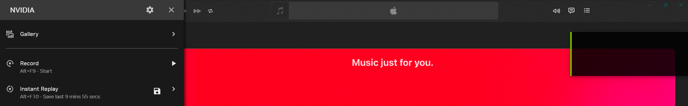

<!-- AI setup by iAlturki -->

  
  &nbsp;&nbsp;
  

Click the setup button, copy the prompt, and give it to your AI agent. <a href="docs/agent-setup/prompt.txt">Read the prompt</a>.

<!-- /AI setup by iAlturki -->

# Nvidia_Instant_Replay_Fix

**Stops NVIDIA Instant Replay (ShadowPlay) from cutting out when a "protected" app — a DRM browser tab, Apple Music, Netflix — is on screen. Set it once; it runs itself.**

## Demo

**Apple Music open and playing — yet Instant Replay stays on. NVIDIA never disables it:**

## Install

1. Download **[`Run.bat`](../../releases/latest/download/Run.bat)** from the latest release.
2. **Double-click it** and approve the prompt (admin is needed once, to register the startup task).

Record/save with your usual NVIDIA hotkey (default **Alt+F10**). To remove it, run `Run.bat` again and choose **Uninstall**.

## Safety

Source-available, single-file C — read it, or build it yourself with `cd c && build.bat`. It runs as you (no admin), keeps no telemetry, and writes only under `%LOCALAPPDATA%\Nvidia_Instant_Replay_Fix\`.

## Credits & license

Based on the approach pioneered by **[furyzenblade/ShadowPlay_Patcher](https://github.com/furyzenblade/ShadowPlay_Patcher)**.

CC BY-NC-SA 4.0 © 2026 **[iAlturki](https://github.com/iAlturki)** — see [LICENSE](LICENSE). Independent, unofficial tool; not affiliated with NVIDIA Corporation.

Current original material is **CC BY-NC-SA 4.0 © iAlturki**. Earlier MIT releases retain their original terms; third-party material retains its own notices. See [NOTICE](NOTICE) and [LICENSES/previous-MIT.txt](LICENSES/previous-MIT.txt).
